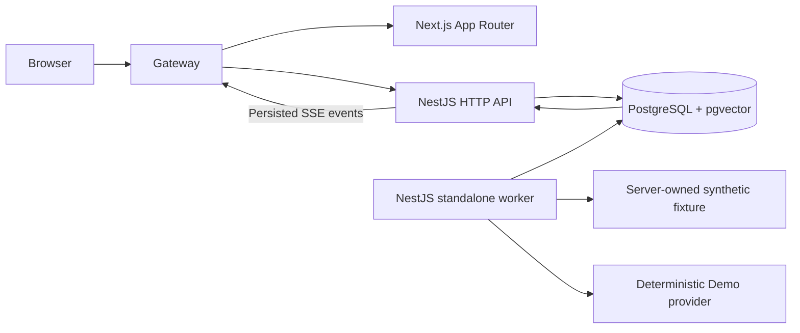

# Architecture

## Boundaries

The frontend consumes only the OpenAPI-generated client. It never receives database credentials or accesses providers/persistence directly. DomainModule supplies shared services and repositories to ApiModule and WorkerModule. WorkerModule starts with `createApplicationContext` and exposes no HTTP listener. Database uses Drizzle for schema and ordinary resource queries, and parameterized pg operations for transactions, FTS, job claims and fencing. No duplicate backend, Redis, BullMQ, Kafka or future agent infrastructure.

## Data and authorization

Workspace → repository → snapshot → file/chunk. Conversations contain user and assistant messages associated with question runs; index runs have no conversation. Run/job creation is atomic. Every resource lookup, search, history, source and SSE query includes workspace_id. Composite foreign keys prevent cross-workspace relationships; an active snapshot must belong to the same repository. A question pins its snapshot when enqueued, so reindexing cannot change its evidence.

Local development identity is the explicit workspace UUID `00000000-0000-4000-8000-000000000001`. It is server-owned, never selected through browser headers or DTOs. Production and DEV_AUTH=false refuse startup. Local origin checks reject cross-origin browser operations; infrastructure binds host ports to loopback. This is a local demo boundary, not a production authentication system.

ValidationPipe transforms DTOs, strips no unexpected fields silently (forbidNonWhitelisted), hides input targets/values in validation errors and uses a consistent safe error envelope. Unknown errors expose no stack, database URL or secret. Swagger creates contracts without connecting to PostgreSQL. Sources include IDs, paths, SHA-256 revisions, original line ranges and excerpts; no provider-generated URLs.

## Index lifecycle

Only the fixed fixture kind can be registered. The API accepts no arbitrary path. Ingestion uses async filesystem I/O, allowlisted extensions, secret/generated/binary exclusions, UTF-8 validation, traversal rejection and symlink avoidance. Limits: 128 files, 512 visited entries, 128 KiB per file, 1 MiB total and depth 8. Line positions are preserved while CRLF is normalized. SHA-256 hashes framed sorted path/content pairs using a versioned hash format.

Read and chunk outside a transaction. Within a fenced transaction, insert the complete snapshot/files/chunks, set the active pointer, persist result and terminal event. A duplicate revision reuses its existing snapshot. Any failure/cancel/lease expiration rolls back activation. SQL triggers prohibit update/delete of snapshot content; new snapshots retain old citations. pgvector is installed for future work but unused for phase 1 search.

## Retrieval and demo response

GIN-indexed PostgreSQL `tsvector`, simple-language full-text OR queries and ts_rank_cd provide a lexical baseline. Exact lowercased identifier/path substrings and camel-case terms add useful code matching. Ranking combines literal term coverage, path matches and native FTS rank with stable tie-breakers. This is not BM25 or semantic similarity. Only the top five excerpts reach the provider; up to three extractive findings are returned.

The provider applies a conservative literal coverage threshold and returns structured Zod-validated output or insufficient evidence. Only actual matched lines are quoted. The backend validates all source_ids against retrieved results and re-resolves them in the workspace and pinned snapshot with file/line checks. This demonstrates grounded extraction, not robust natural-language reasoning or prompt-injection-resistant autonomous agency. React displays text without raw HTML.

## Job state machine

Run states: queued → running → completed / failed / cancelled. Recoverable attempts transition running → queued. Jobs: pending → processing → completed / failed / cancelled; retry/recovery transitions processing → pending. Queued cancellation is immediate; processing cancellation is cooperative at worker checkpoints and the final atomic commit.

Each worker processes one job at a time. Short claims use FOR UPDATE SKIP LOCKED and increment attempt and fence. Lease is 15 seconds by default, heartbeat every third of the lease. Every event/result write locks and checks current fence, processing state and unexpired lease. Completion checks wall-clock time again before committing all side effects. Expired workers cannot finalize, even if they resume later. Recovery increments the fence, requeues or fails after three attempts. SQL transactions are never held open during file reads, retrieval or provider work.

Shutdown stops polling, aborts processing cooperatively and persists retry/failure where the lease permits; a hard stop is recovered by lease expiration. On Windows the portable supervisor terminates its own child process trees; leases cover forced termination. On Linux it signals owned children. SQL connection errors are sanitized and polling retries. A maximum of 100 active jobs per workspace bounds the demo queue; history returns the most recent 50 runs. Production scheduling/retention/quotas are deferred.

## Streaming

run_events has a persisted monotonic sequence. Writes for a run serialize through its job lock. SSE `id` is the sequence, event name is `run`, JSON payload is generated EventDto. Replay accepts Last-Event-ID or an initial after cursor. Frontend deduplicates sequences and polls the canonical run as fallback. Terminal events close the stream. Disconnect does not cancel the job. A process limits connections to 32, polls at bounded intervals, sends keepalives and disconnects slow clients rather than buffering unbounded output. The local gateway forwards SSE as an ordinary unbuffered HTTP stream.

Migrations run once through a dedicated command/service, protected with a PostgreSQL advisory lock. API/worker startup does not mutate schema. Persistent Compose volumes preserve results and history across restarts.
